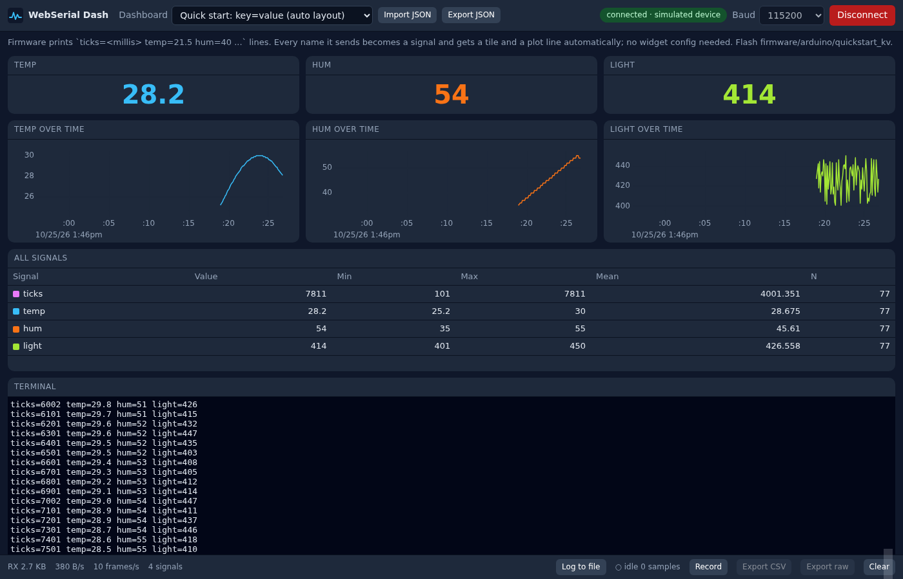

# WebSerial Dash

A serial debug terminal and live data dashboard that runs entirely in the browser over the Web Serial API.
Describe what your board prints in one JSON file (or let an AI agent write it) and get plots, gauges, LEDs, a terminal and CSV logging — on a laptop or an Android phone, with no install and no backend.
Built to be extended by agents: config first, explicit registries, one `pnpm check`.


## Try it

Live demos with a simulated device, no hardware needed:

| Example | What it shows |
|---|---|
| [Quick start](https://SuperChange001.github.io/webserial-dash/?dashboard=quickstart&demo) | No widget config at all: every `name=value` the board prints gets a tile and a plot |
| [Wi-Fi RSSI + speed test](https://SuperChange001.github.io/webserial-dash/?dashboard=wifi-speedtest&demo) | Gauges with min/max, live and per-test history plots, command buttons ([walkthrough](docs/CUSTOMIZE.md)) |
| [CSV sensor board](https://SuperChange001.github.io/webserial-dash/?dashboard=demo-sensor&demo) | Gauge with thresholds, LED, buttons, table, terminal |
| [Teleplot](https://SuperChange001.github.io/webserial-dash/?dashboard=teleplot&demo) · [ESP-IDF log](https://SuperChange001.github.io/webserial-dash/?dashboard=esp-log&demo) | Other line formats |

Drop `&demo`, click **Connect** and pick a port to use your own board.

## Quick start

```sh
git clone https://github.com/SuperChange001/webserial-dash.git
cd webserial-dash
pnpm install
pnpm dev          # http://localhost:5173/?dashboard=quickstart&demo
```

Requires Node >= 20 and pnpm (`corepack enable`). `pnpm check` runs typecheck, lint, unit tests and dashboard validation.

## Send data from your board

Print one line per sample with `name=value` pairs. Include a tick counter if you like; the
dashboard can use it for exact timing or just record it.

```c
// Arduino / ESP32: 10 times per second
Serial.printf("ticks=%lu temp=%.1f hum=%d light=%d\n", millis(), temp, hum, analogRead(A0));
```

Open `?dashboard=quickstart`, click **Connect**, and every name appears with its own tile and
plot. Add `co2=612` to the print and a CO2 tile appears; no dashboard edit needed. Text without
`=` (boot messages, debug prints) stays visible in the terminal and is otherwise ignored.



Ready-to-flash sketches are in [firmware/](firmware/). Other formats (CSV, JSON, Teleplot, regex
over log lines, binary structs) and when to use them: [docs/PROTOCOLS.md](docs/PROTOCOLS.md).

## Customize with an AI agent

The repo ships with `AGENTS.md` (read by Claude Code, Codex, Cursor, Copilot, Gemini CLI) plus Claude Code skills under `.claude/skills/`. A one-line prompt is usually enough:

```
My board prints "T=23.5 H=41" every 200 ms at 115200 baud.
Show temperature as a gauge, red above 80, and plot humidity.
```

The agent writes `dashboards/<id>.json` with a matching `simulate` block, runs `pnpm validate:dashboards`, and tells you to open `/?dashboard=<id>&demo` to check the result before plugging in hardware. New widget or parser *kinds* are the only things that need TypeScript; the skills `add-widget` and `add-parser` cover those paths.

**[docs/CUSTOMIZE.md](docs/CUSTOMIZE.md) walks through a full example:** the prompt, the JSON it produces, the result in Demo mode, a second prompt that changes the view, and loading the edited file with **Import JSON**.

Without an agent: copy an example from `dashboards/`, edit it with editor completion from `schema/dashboard.schema.json`, and read `docs/CONFIG.md`.

## How much data the page keeps, and logging to files

| Where | Capacity | Notes |
|---|---|---|
| Plots, gauges, tables | `options.bufferSamples` per signal, default 20,000 | About 33 minutes at 10 Hz or 20 s at 1 kHz. 16 bytes per sample; raise it in the dashboard JSON if needed. Min/max/mean cover the whole session. |
| **Record** button | Up to 1,000,000 samples and 8 MB of raw bytes, in memory | Then **Export CSV** or **Export raw**. Lost when the tab closes. |
| **Log to file** button | Limited by disk space | Streams every parsed line to CSV while you watch. |

**Log to file** writes a wide CSV (one row per received line, one column per signal) in parts of
one minute each, so a crash loses at most the last minute:

- Desktop Chrome/Edge asks for a folder and writes `<dashboard>-<time>-part0001.csv`, `…-part0002.csv` there.
- Android and other browsers write into the browser's private storage; after **Stop file log**, **Download log** merges the parts into one CSV and frees the space.
- When a new signal appears mid-session a new part starts with the extended header.

## Features

- Web Serial transport with DTR/RTS control, board reset pulse, recoverable-error handling and device-loss detection
- Framing: newline/custom delimiter, start/end markers, fixed length
- Parsers: CSV, key=value, JSON (nested), Teleplot, regex over log lines, binary structs (`<Hhf`)
- Widgets: plot (uPlot), value, gauge, LED, table with stats, log with regex filter, xterm.js terminal with send box and history, command buttons
- Per-signal metadata: label, unit, scale/offset, decimals, colour; thresholds for colour steps
- Continuous **Log to file** (rotating CSV parts on disk or in browser storage), in-memory Record with CSV / raw export, import/export dashboards as JSON
- Optional device timestamps (`ticks=` from `millis()`/`micros()`) for exact sample timing
- Auto layout: a dashboard with no widgets builds itself from the names the firmware sends
- Demo mode: every dashboard carries a simulated device, including scripted replies to commands, so `?demo` works on GitHub Pages and in tests
- PWA, dark UI, responsive 12-column grid that collapses on phones
- Framework-free core (`src/core`) tested in Node with a fake `SerialPort`; Playwright e2e with an injected fake `navigator.serial`

## Browser support

| Platform | Status |
|---|---|
| Chrome / Edge / Opera, desktop (Windows, macOS, Linux, ChromeOS) | Supported |
| Android Chrome 148+ (USB via OTG), 138+ (Bluetooth RFCOMM) | Supported; install as PWA |
| Firefox | Not supported (Web Serial behind an add-on permission model, untested) |
| Safari / iOS | Not supported (no Web Serial) |
| Any browser | Demo mode works everywhere |

Web Serial requires HTTPS or `localhost`.

## Repository layout

```
dashboards/      example dashboards (JSON)            src/core/      transport, framing, parsers, store, logger
schema/          generated dashboard.schema.json      src/config/    zod schema + dashboard loading
scripts/         gen-schema, validate, scaffolds      src/widgets/   one dir per widget + registries
tests/           e2e (Playwright) + fixtures          src/app/       React shell, Session wiring
firmware/        Arduino sketches for the examples    src/testing/   FakeSerialPort
docs/            architecture, config, protocols, testing, deploy, plan, study
```

## Documentation

- [docs/CONFIG.md](docs/CONFIG.md) — every dashboard JSON key, widget option and default
- [docs/PROTOCOLS.md](docs/PROTOCOLS.md) — what each parser expects, with firmware snippets
- [docs/ARCHITECTURE.md](docs/ARCHITECTURE.md) — data flow, interfaces, extension points
- [docs/TESTING.md](docs/TESTING.md) — unit, e2e, virtual ports, captures as fixtures
- [docs/DEPLOY.md](docs/DEPLOY.md) — GitHub Pages, custom domain, PWA, self-hosting
- [docs/PLAN.md](docs/PLAN.md) · [docs/STUDY.md](docs/STUDY.md) — roadmap and prior-art study
- [AGENTS.md](AGENTS.md) — instructions for coding agents (and humans in a hurry)

## License

MIT.

## Credits

Patterns and ideas borrowed from [esptool-js](https://github.com/espressif/esptool-js) (transport/port abstraction), [serial-terminal](https://github.com/GoogleChromeLabs/serial-terminal) (xterm + Web Serial reading), [Teleplot](https://github.com/nesnes/teleplot) (line protocol), [Serial Studio](https://github.com/Serial-Studio/Serial-Studio) (declarative dashboard DSL). Rendering by [uPlot](https://github.com/leeoniya/uPlot) and [xterm.js](https://github.com/xtermjs/xterm.js).
