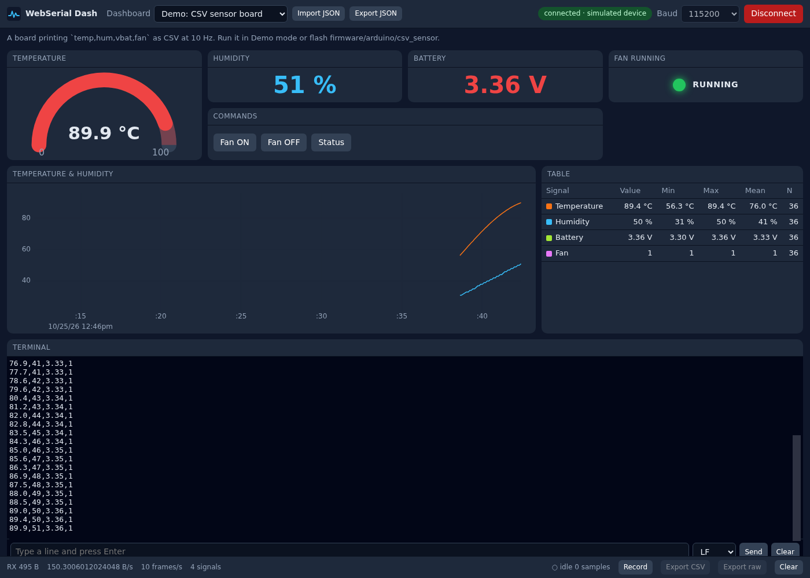

# WebSerial Dash

A serial debug terminal and live data dashboard that runs entirely in the browser over the Web Serial API.
Describe what your board prints in one JSON file (or let an AI agent write it) and get plots, gauges, LEDs, a terminal and CSV logging — on a laptop or an Android phone, with no install and no backend.
Built to be extended by agents: config first, explicit registries, one `pnpm check`.



## Try it

Live demo (simulated device, no hardware needed): **https://SuperChange001.github.io/webserial-dash/?dashboard=demo-sensor&demo**

Other examples: [`?dashboard=teleplot&demo`](https://SuperChange001.github.io/webserial-dash/?dashboard=teleplot&demo) · [`?dashboard=esp-log&demo`](https://SuperChange001.github.io/webserial-dash/?dashboard=esp-log&demo). Drop `&demo`, click **Connect** and pick a port to use your own board.

## Quick start

```sh
git clone https://github.com/SuperChange001/webserial-dash.git
cd REPO
pnpm install
pnpm dev          # http://localhost:5173/?dashboard=demo-sensor&demo
```

Requires Node >= 20 and pnpm (`corepack enable`). `pnpm check` runs typecheck, lint, unit tests and dashboard validation.

## Customize with an AI agent

The repo ships with `AGENTS.md` (read by Claude Code, Codex, Cursor, Copilot, Gemini CLI) plus Claude Code skills under `.claude/skills/`. A one-line prompt is usually enough:

```
My board prints "T=23.5 H=41" every 200 ms at 115200 baud.
Show temperature as a gauge, red above 80, and plot humidity.
```

The agent writes `dashboards/<id>.json` with a matching `simulate` block, runs `pnpm validate:dashboards`, and tells you to open `/?dashboard=<id>&demo` to check the result before plugging in hardware. New widget or parser *kinds* are the only things that need TypeScript; the skills `add-widget` and `add-parser` cover those paths.

Without an agent: copy an example from `dashboards/`, edit it with editor completion from `schema/dashboard.schema.json`, and read `docs/CONFIG.md`.

## Features

- Web Serial transport with DTR/RTS control, board reset pulse, recoverable-error handling and device-loss detection
- Framing: newline/custom delimiter, start/end markers, fixed length
- Parsers: CSV, key=value, JSON (nested), Teleplot, regex over log lines, binary structs (`<Hhf`)
- Widgets: plot (uPlot), value, gauge, LED, table with stats, log with regex filter, xterm.js terminal with send box and history, command buttons
- Per-signal metadata: label, unit, scale/offset, decimals, colour; thresholds for colour steps
- Record session → export wide CSV or the raw byte capture; import/export dashboards as JSON
- Demo mode: every dashboard carries a simulated device, so `?demo` works on GitHub Pages and in tests
- PWA, dark UI, responsive 12-column grid that collapses on phones
- Framework-free core (`src/core`) tested in Node with a fake `SerialPort`; Playwright e2e with an injected fake `navigator.serial`

## Browser support

| Platform | Status |
|---|---|
| Chrome / Edge / Opera, desktop (Windows, macOS, Linux, ChromeOS) | Supported |
| Android Chrome 148+ (USB via OTG), 138+ (Bluetooth RFCOMM) | Supported; install as PWA |
| Firefox | Not supported (Web Serial behind an add-on permission model, untested) |
| Safari / iOS | Not supported (no Web Serial) |
| Any browser | Demo mode works everywhere |

Web Serial requires HTTPS or `localhost`.

## Repository layout

```
dashboards/      example dashboards (JSON)            src/core/      transport, framing, parsers, store, logger
schema/          generated dashboard.schema.json      src/config/    zod schema + dashboard loading
scripts/         gen-schema, validate, scaffolds      src/widgets/   one dir per widget + registries
tests/           e2e (Playwright) + fixtures          src/app/       React shell, Session wiring
firmware/        Arduino sketches for the examples    src/testing/   FakeSerialPort
docs/            architecture, config, protocols, testing, deploy, plan, study
```

## Documentation

- [docs/CONFIG.md](docs/CONFIG.md) — every dashboard JSON key, widget option and default
- [docs/PROTOCOLS.md](docs/PROTOCOLS.md) — what each parser expects, with firmware snippets
- [docs/ARCHITECTURE.md](docs/ARCHITECTURE.md) — data flow, interfaces, extension points
- [docs/TESTING.md](docs/TESTING.md) — unit, e2e, virtual ports, captures as fixtures
- [docs/DEPLOY.md](docs/DEPLOY.md) — GitHub Pages, custom domain, PWA, self-hosting
- [docs/PLAN.md](docs/PLAN.md) · [docs/STUDY.md](docs/STUDY.md) — roadmap and prior-art study
- [AGENTS.md](AGENTS.md) — instructions for coding agents (and humans in a hurry)

## License

MIT.

## Credits

Patterns and ideas borrowed from [esptool-js](https://github.com/espressif/esptool-js) (transport/port abstraction), [serial-terminal](https://github.com/GoogleChromeLabs/serial-terminal) (xterm + Web Serial reading), [Teleplot](https://github.com/nesnes/teleplot) (line protocol), [Serial Studio](https://github.com/Serial-Studio/Serial-Studio) (declarative dashboard DSL). Rendering by [uPlot](https://github.com/leeoniya/uPlot) and [xterm.js](https://github.com/xtermjs/xterm.js).
