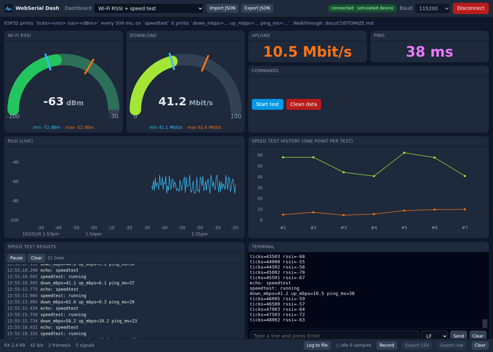
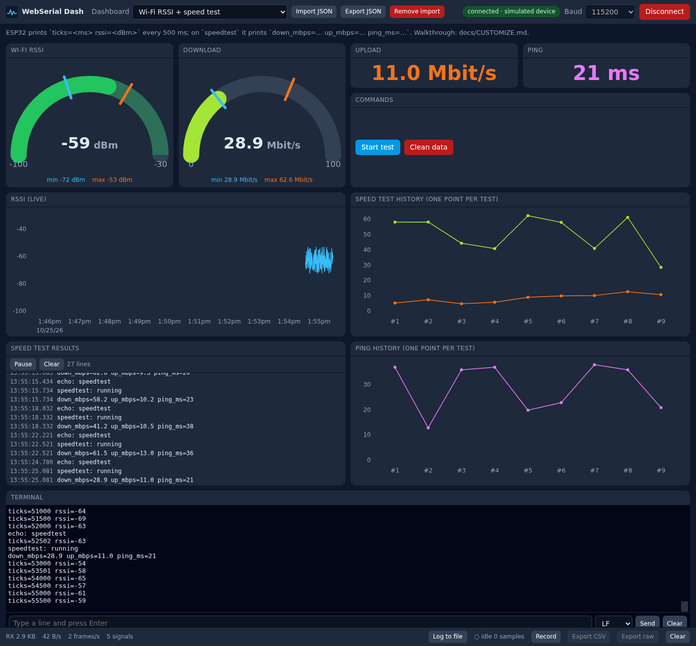
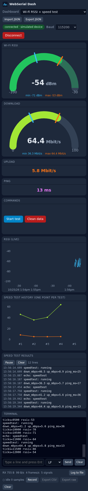

# Customizing a dashboard: a worked example

This page walks through one complete customization, from the sentence you type to an AI agent
to the dashboard you see in the browser. The example is an ESP32 that reports Wi-Fi signal
strength (RSSI) and runs an internet speed test on request.

You will see:

1. what the board has to print,
2. the prompt,
3. the JSON the agent writes and how each requirement maps to it,
4. the result in Demo mode, without hardware,
5. a second prompt that changes the view, the diff, and how to load it,
6. connecting the real board.

## How a dashboard is put together

```
board prints a line ──► parser turns it into named signals ──► widgets reference signals by name
"ticks=5300 rssi=-61"        ticks=5300, rssi=-61                 gauge "rssi", plot ["rssi"]
```

A dashboard is one JSON file in `dashboards/<id>.json`. It holds the serial settings, the
parser, optional display metadata per signal (label, unit, colour), and the list of widgets.
Customizing a dashboard means editing that file; no TypeScript is involved.

There are two ways to load a changed file:

| Where you work | How the change shows up |
|---|---|
| In a clone of the repo, with `pnpm dev` running | Save `dashboards/<id>.json`; the page reloads |
| Only in the browser, e.g. on GitHub Pages or a phone | **Import JSON** in the top bar. The import is stored in the browser and replaces a built-in dashboard with the same `id`. **Remove import** restores the built-in one. |

## Step 1: decide what the board prints

Use self-describing `name=value` lines (the `kv` parser). Every name the board prints becomes a
signal, so the firmware is the single source of truth for names. Send a tick counter as well; the
dashboard can use it for exact sample timing or ignore it (see [PROTOCOLS.md](PROTOCOLS.md#device-timestamps)).

| When | Board prints |
|---|---|
| Every 500 ms | `ticks=5300 rssi=-61` |
| After it receives the command `speedtest` | `speedtest: running` then `down_mbps=42.1 up_mbps=11.3 ping_ms=17` |

Lines without `=` such as `speedtest: running` are ignored by the parser but still appear in the
terminal and log widgets.

## Step 2: the prompt

Open the repo in Claude Code, Codex or Cursor and describe the device and the view you want.
Name the exact line format, the units, the value ranges and what each button should do.

```text
My ESP32 prints "ticks=<millis> rssi=<dBm>" every 500 ms at 115200 baud.
When it receives the line "speedtest" it runs a speed test and prints
"down_mbps=<float> up_mbps=<float> ping_ms=<int>".

Make a dashboard "wifi-speedtest":
- a live RSSI curve (last 2 minutes, -100 to -30 dBm)
- a history curve of the speed test results, download and upload
- gauges for RSSI and download speed that also show the min and max seen
- upload and ping as big numbers
- two buttons: "Start test" sends speedtest, "Clean data" clears the plots
- a log of the speed test results and the raw terminal
Make Demo mode answer "speedtest" with random plausible results.
```

The agent follows the `customize-dashboard` skill: it writes `dashboards/wifi-speedtest.json`,
runs `pnpm validate:dashboards`, and asks you to check it in Demo mode.

## Step 3: the generated JSON

This is the file the prompt produces, [dashboards/wifi-speedtest.json](../dashboards/wifi-speedtest.json):

```json
{
  "$schema": "../schema/dashboard.schema.json",
  "id": "wifi-speedtest",
  "name": "Wi-Fi RSSI + speed test",
  "order": 10,
  "description": "ESP32 prints `ticks=<ms> rssi=<dBm>` every 500 ms; on `speedtest` it prints `down_mbps=… up_mbps=… ping_ms=…`. Walkthrough: docs/CUSTOMIZE.md.",
  "source": {
    "baudRate": 115200,
    "parser": { "type": "kv" },
    "timestamp": { "field": "ticks", "ticksPerSecond": 1000, "use": true },
    "simulate": {
      "intervalMs": 500,
      "format": "kv",
      "signals": [
        { "name": "ticks", "waveform": "millis", "decimals": 0 },
        { "name": "rssi", "waveform": "noise", "min": -72, "max": -52, "decimals": 0 }
      ],
      "responses": {
        "speedtest": [
          "speedtest: running",
          "down_mbps={{rand:18:65:1}} up_mbps={{rand:4:14:1}} ping_ms={{rand:9:40:0}}"
        ]
      }
    }
  },
  "signals": {
    "rssi": { "label": "Wi-Fi RSSI", "unit": "dBm", "decimals": 0, "color": "#38bdf8" },
    "down_mbps": { "label": "Download", "unit": "Mbit/s", "decimals": 1, "color": "#a3e635" },
    "up_mbps": { "label": "Upload", "unit": "Mbit/s", "decimals": 1, "color": "#f97316" },
    "ping_ms": { "label": "Ping", "unit": "ms", "decimals": 0, "color": "#e879f9" }
  },
  "widgets": [
    {
      "id": "rssi-gauge", "type": "gauge", "signal": "rssi", "min": -100, "max": -30, "showMinMax": true,
      "thresholds": [{ "value": -100, "color": "#ef4444" }, { "value": -80, "color": "#eab308" }, { "value": -67, "color": "#22c55e" }],
      "x": 0, "y": 0, "w": 3, "h": 3
    },
    { "id": "down-gauge", "type": "gauge", "signal": "down_mbps", "min": 0, "max": 100, "showMinMax": true, "x": 3, "y": 0, "w": 3, "h": 3 },
    { "type": "value", "signal": "up_mbps", "x": 6, "y": 0, "w": 3, "h": 1 },
    { "type": "value", "signal": "ping_ms", "x": 9, "y": 0, "w": 3, "h": 1 },
    {
      "id": "commands", "type": "button", "title": "Commands",
      "actions": [
        { "label": "Start test", "send": "speedtest", "color": "#0284c7" },
        { "label": "Clean data", "local": "clearData", "color": "#b91c1c", "confirm": "Clear all plots, min/max and stats?" }
      ],
      "x": 6, "y": 1, "w": 6, "h": 2
    },
    { "id": "rssi-plot", "type": "plot", "title": "RSSI (live)", "signals": ["rssi"], "timeWindowSec": 120, "yMin": -100, "yMax": -30, "x": 0, "y": 3, "w": 6, "h": 3 },
    { "id": "speed-history", "type": "plot", "title": "Speed test history (one point per test)", "signals": ["down_mbps", "up_mbps"], "xAxis": "index", "maxPoints": 30, "yMin": 0, "x": 6, "y": 3, "w": 6, "h": 3 },
    { "type": "log", "title": "Speed test results", "filter": "speedtest|down_mbps", "x": 0, "y": 6, "w": 6, "h": 3 },
    { "type": "terminal", "x": 6, "y": 6, "w": 6, "h": 3 }
  ],
  "options": { "bufferSamples": 20000, "timeWindowSec": 120 }
}
```

How each requirement maps to the JSON:

| Requirement | JSON |
|---|---|
| Board prints `name=value` lines | `source.parser = { "type": "kv" }` |
| Board sends its own clock | `source.timestamp = { "field": "ticks", "ticksPerSecond": 1000 }` |
| Units, labels, colours | `signals.rssi = { "label": "Wi-Fi RSSI", "unit": "dBm", ... }` |
| Live RSSI curve, 2 minutes, fixed range | `plot` with `signals: ["rssi"]`, `timeWindowSec: 120`, `yMin`/`yMax` |
| Speed test history | `plot` with `xAxis: "index"`: one point per test, so tests minutes apart stay readable |
| Gauges with min and max | `gauge` with `showMinMax: true`; RSSI also gets colour `thresholds` |
| Upload and ping as numbers | `value` widgets |
| "Start test" | button action `{ "send": "speedtest" }` |
| "Clean data" | button action `{ "local": "clearData" }`, handled by the page, nothing is sent |
| Demo answers the command | `simulate.responses.speedtest` with `{{rand:min:max:decimals}}` placeholders |
| Layout | `x`, `y`, `w`, `h` on a 12-column grid; one row is about 90 px. Phones stack widgets in reading order. |

## Step 4: check it without hardware

Open the dashboard with `&demo`; a simulated device produces the RSSI stream and answers the
**Start test** button:

- local: `http://localhost:5173/?dashboard=wifi-speedtest&demo`
- hosted: <https://SuperChange001.github.io/webserial-dash/?dashboard=wifi-speedtest&demo>

After clicking **Start test** a few times:



- The RSSI gauge shows the current value, colour-coded, with blue and orange ticks at the lowest and highest values seen.
- The download gauge stays empty until the first test, then keeps its own min and max.
- The history plot adds one point per test; the RSSI plot scrolls in real time.
- **Clean data** asks for confirmation, then resets plots, gauges, min/max and the statistics.

## Step 5: change the view with a second prompt

```text
In wifi-speedtest: make the RSSI gauge simply red below -75 dBm and green above,
show 10 minutes in the RSSI curve, and add a ping history plot next to the results log.
```

The agent edits only the widgets; the parser and the signals stay the same:

```diff
   "id": "rssi-gauge", "type": "gauge", "signal": "rssi", ...
-  "thresholds": [{ "value": -100, "color": "#ef4444" }, { "value": -80, "color": "#eab308" }, { "value": -67, "color": "#22c55e" }],
+  "thresholds": [{ "value": -100, "color": "#ef4444" }, { "value": -75, "color": "#22c55e" }],

   "id": "rssi-plot", "type": "plot", ...
-  "timeWindowSec": 120,
+  "timeWindowSec": 600,

+  { "id": "ping-history", "type": "plot", "title": "Ping history (one point per test)",
+    "signals": ["ping_ms"], "xAxis": "index", "maxPoints": 30, "yMin": 0, "x": 6, "y": 6, "w": 6, "h": 3 },

   { "type": "terminal", ...
-    "x": 6, "y": 6, "w": 6, "h": 3 }
+    "x": 0, "y": 9, "w": 12, "h": 3 }
```

The full edited file is [docs/examples/wifi-speedtest-v2.json](examples/wifi-speedtest-v2.json).
Load it with **Import JSON**, or save it over `dashboards/wifi-speedtest.json` in the repo.
Because only the presentation changed, the page keeps the data it already has and redraws it
with the new layout. Changing the parser, the timestamp settings or `signals` starts with empty
buffers instead.



On a phone the same file renders as a single column in reading order:



## Step 6: connect the real board

1. Flash [firmware/arduino/wifi_speedtest](../firmware/arduino/wifi_speedtest/wifi_speedtest.ino) after setting your Wi-Fi name and password. This sketch has not been compiled or run by the maintainers yet; please report problems.
2. Close any other serial monitor.
3. Open `?dashboard=wifi-speedtest` without `&demo`, click **Connect** and pick the board.

If the board prints something slightly different, for example `RSSI: -61`, you do not need new
firmware. Ask the agent to adapt the parser, here a `regex` parser with a named group, and keep
the widgets.

## Prompt cookbook

| You say | The agent changes |
|---|---|
| "show X as a gauge from 0 to 5 V" | adds `{ "type": "gauge", "signal": "X", "min": 0, "max": 5 }` |
| "red above 80" | `thresholds: [{ "value": 80, "color": "#ef4444" }]` on that widget |
| "show min and max" | `showMinMax: true` on a gauge, or a `table` widget with `stats: true` |
| "plot A and B together, last 5 minutes" | `plot` with `signals: ["A","B"]`, `timeWindowSec: 300` |
| "one point per measurement" | `plot` with `xAxis: "index"` |
| "the board sends millivolts, show volts" | `signals.X.scale: 0.001`, `unit: "V"` |
| "a button that sends reset" | `button` action `{ "label": "Reset", "send": "reset" }` |
| "a button that clears the screen" | `button` action `{ "local": "clearData" }` |
| "an LED that is on when the pump runs" | `led` with `when: { "op": ">", "value": 0 }` |
| "only show error lines" | `log` with `filter: "^E "` |
| "use the board's timestamps" | `source.timestamp` |

Tips for a good prompt:

- Paste two or three real lines from the terminal instead of describing them.
- Give units and the expected range; gauges and fixed plot axes need them.
- Say what each button sends, including the line ending if the firmware is picky.
- Ask for a `simulate` block so you can check the result before touching hardware.

All widget and parser options are listed in [CONFIG.md](CONFIG.md).
